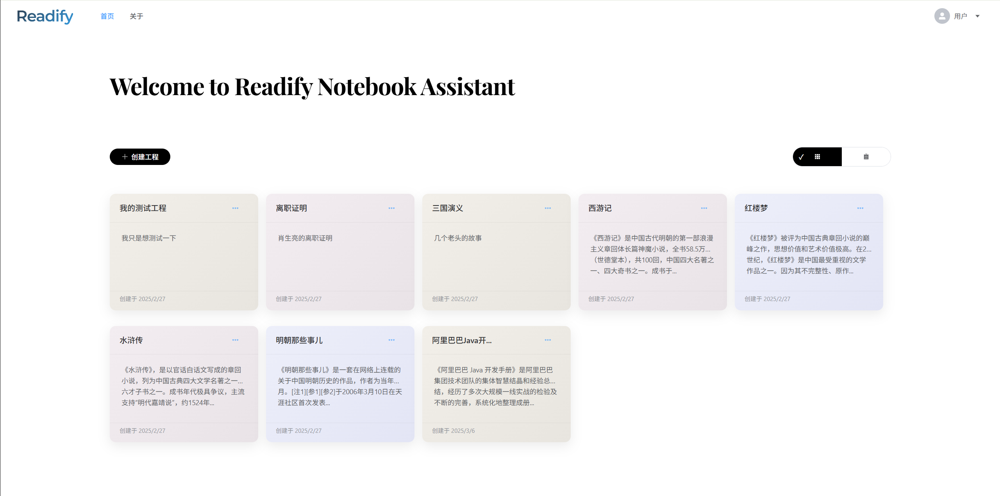
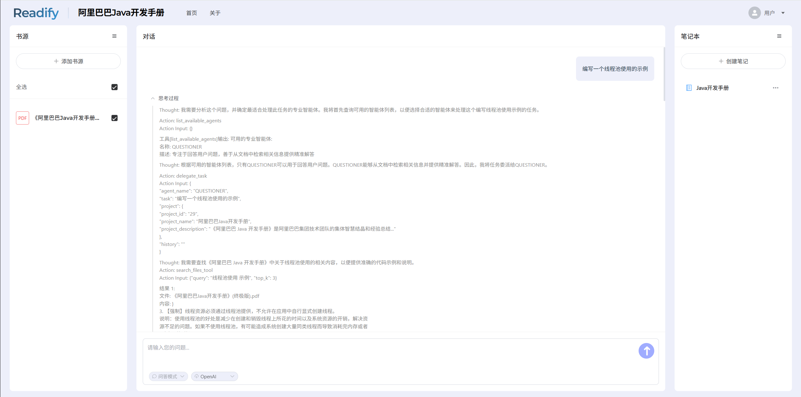
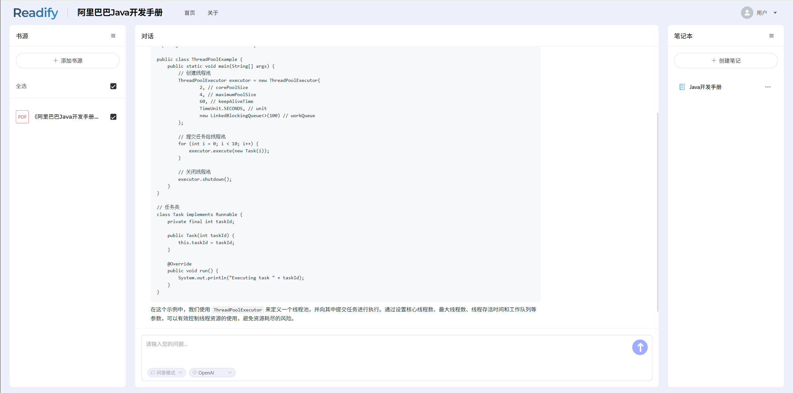
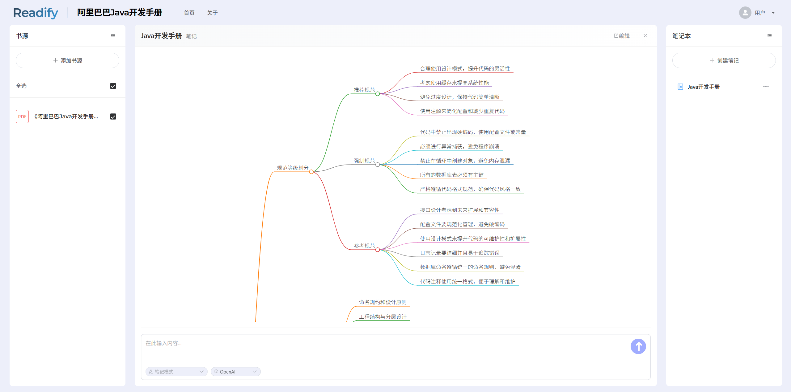
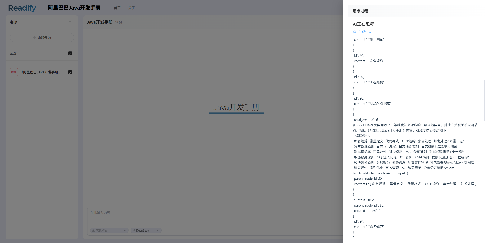
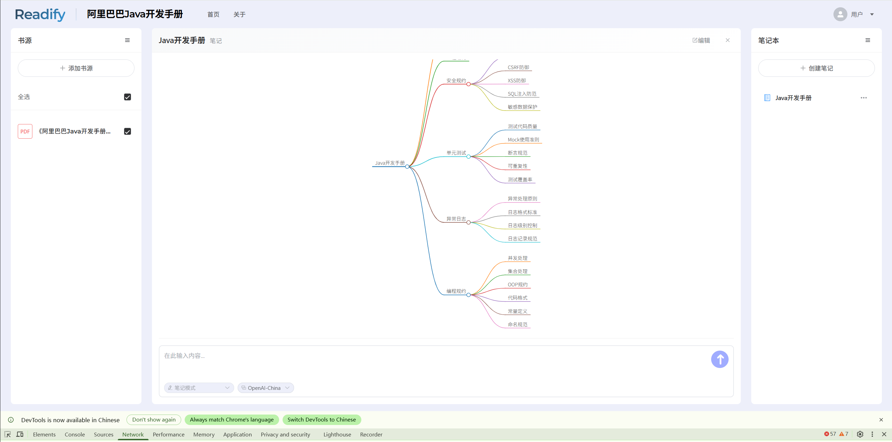

# Readify - 智能阅读笔记助手

<div align="center">

[English](README.md) | [日本語](README_ja.md)

  
  
  
  
  

  <h3>基于AI的智能阅读笔记和思维导图生成工具</h3>
</div>

## 项目概述

Readify 是一个智能阅读笔记助手，通过AI技术帮助用户轻松整理知识并生成直观的思维导图。项目采用微服务架构，由五个核心模块组成：

- **readify_frontend** — 基于 Vue 3 + TypeScript 的前端应用
- **readify_server** — 基于 Spring Boot 3.2.2 的后端服务（DDD架构）
- **readify_agi** — 基于 FastAPI 的 AI 服务层（多Agent系统）
- **readify_admin** — 基于 Vue 3 + TypeScript 的管理后台（RBAC权限管理）
- **readify_eval** — 评测平台（包含 backend/frontend 两部分）

## 功能展示

<div align="center">
  
  <p><i>首页 - 项目管理和文档上传</i></p>

  
  <p><i>对话界面 - 思考过程</i></p>

  
  <p><i>对话界面 - 最终答案</i></p>

  
  <p><i>笔记界面 - 笔记管理</i></p>

  
  <p><i>笔记生成 - 自动分析</i></p>

  
  <p><i>笔记生成 - 结果展示</i></p>
</div>

## 核心功能

- **智能问答** — 基于RAG（检索增强生成）的文档问答，结合向量检索和LLM
- **智能笔记生成** — 支持多层级生成结构化笔记
- **思维导图可视化** — 基于 markmap.js 的交互式知识图谱
- **多Agent协作** — Coordinator、Ask、Note 等多智能体协作
- **多种AI模型支持** — 支持 OpenAI、Qwen、DeepSeek 等 OpenAI 兼容模型
- **多格式文档支持** — 支持 PDF、TXT、DOCX 等（通过 LlamaParse 解析）
- **实时流式反馈** — 思考过程通过 WebSocket/SSE 实时展示

## 技术架构

```
readify_parent/
├── readify_frontend/    # Vue 3 前端
├── readify_server/      # Spring Boot 后端
├── readify_agi/         # FastAPI AI 智能体服务
├── readify_admin/       # Vue 3 管理后台
├── readify_eval/        # 评测平台
└── infra/               # 基础设施（Docker Compose）
```

### 服务通信流程

```
前端 (5173) → 后端服务 (8080) → AGI 服务 (8081)
                    ↕                ↕
                Nacos (8848) — 服务发现与配置中心
                    ↓
                MySQL — 共享业务数据库
                Milvus — 向量数据库
                MinIO — 对象存储
```

### 技术栈

| 模块 | 技术栈 |
|------|--------|
| **Frontend** | Vue 3, TypeScript, Element Plus, Vite, markmap.js |
| **Server** | Java 17, Spring Boot 3.2.2, MyBatis-Plus, Spring Cloud |
| **AGI** | Python 3.9+, FastAPI, LangChain, OpenAI SDK |
| **数据库** | MySQL 8.0+（业务数据），Milvus（向量存储） |
| **存储** | MinIO |
| **服务发现** | Nacos 2.x |

## 快速开始

### 前提条件

**Docker 部署（推荐）**
- Docker >= 20.10
- Docker Compose >= 2.0

**本地开发**
- Node.js 16+、JDK 17+、Python 3.9+、MySQL 8.0+

### 1. 启动基础设施

```bash
docker compose -f infra/docker-compose.yml up -d
```

启动：Nacos (8848)、MySQL (3307)、Milvus (19530)、MinIO (9000/9001)。

### 2. 初始化数据库

```bash
mysql -h 127.0.0.1 -P 3307 -u root -proot -e "CREATE DATABASE IF NOT EXISTS readify DEFAULT CHARACTER SET utf8mb4 COLLATE utf8mb4_unicode_ci;"
mysql -h 127.0.0.1 -P 3307 -u root -proot readify < readify_server/src/main/resources/db/migration/db.sql

mysql -h 127.0.0.1 -P 3307 -u root -proot -e "CREATE DATABASE IF NOT EXISTS readify_eval DEFAULT CHARACTER SET utf8mb4 COLLATE utf8mb4_unicode_ci;"
mysql -h 127.0.0.1 -P 3307 -u root -proot readify_eval < readify_eval/sql/readify_eval_flow.sql
```

### 3. 配置 AGI 服务

```bash
cd readify_agi
cp .env.example .env
vim .env
```

关键配置项：
```env
LLM_API_KEY=你的密钥
LLM_API_BASE=http://your-openai-compatible-endpoint/v1
LLM_MODEL_NAME=模型名称
EMBEDDING_API_KEY=your_embedding_key
EMBEDDING_API_BASE=your_embedding_url
EMBEDDING_MODEL=your_embedding_model
LLAMA_PARSE_API_KEY=your_llamaparse_key   # 或设置 PARSER_PROVIDER=local
NACOS_NAMESPACE=ca5b6af9-5336-42f7-b68c-515779f79a98
```

### Nacos 配置文件

> Namespace 和 Group 需全链路一致（Group 统一为 `READIFY`）。

**Data ID：`readify-server.yaml`**

```yaml
server:
  port: 8080
spring:
  datasource:
    url: jdbc:mysql://mysql8:3306/readify?useUnicode=true&characterEncoding=utf-8&useSSL=false&serverTimezone=Asia/Shanghai&allowPublicKeyRetrieval=true
    username: root
    password: {数据库密码}
  mvc:
    servlet:
      path: /api/v1
  servlet:
    multipart:
      max-file-size: 100MB
      max-request-size: 100MB
mybatis-plus:
  configuration:
    map-underscore-to-camel-case: true
  global-config:
    db-config:
      id-type: auto
      logic-delete-field: deleted
      logic-delete-value: 1
      logic-not-delete-value: 0
  mapper-locations: classpath*:/mapper/**/*.xml
  type-aliases-package: com.readify.server.infrastructure.persistence.entity
jwt:
  secret: {JWT密钥}
  validity-in-seconds: 86400
readify:
  file:
    storage-type: minio
    minio:
      endpoint: http://milvus-minio:9000
      access-key: minioadmin
      secret-key: minioadmin
      bucket: readify
  agi-service:
    name: readify-agi
```

**Data ID：`readify-agi.yaml`**

```yaml
DB_HOST: mysql8
DB_PORT: 3306
DB_USER: root
DB_PASSWORD: {密码}
DB_NAME: readify

MILVUS_HOST: milvus-standalone
MILVUS_PORT: 19530

LLAMA_PARSE_API_KEY: {LLAMA_PARSE_API_KEY}

LLM_API_KEY: {LLM_API_KEY}
LLM_API_BASE: {openai格式的地址}
LLM_MODEL_NAME: {模型名称}

EMBEDDING_API_KEY: {your_embedding_key}
EMBEDDING_API_BASE: {your_embedding_url}
EMBEDDING_MODEL: {your_embedding_model}

MINIO_ENDPOINT: http://milvus-minio:9000
MINIO_ACCESS_KEY: minioadmin
MINIO_SECRET_KEY: minioadmin
MINIO_SECURE: false

READIFY_SERVER_SERVICE_NAME: readify-server
SERPAPI_API_KEY: {serpapi_key}
```

**Data ID：`readify-eval.yaml`**

```yaml
app:
  name: "Readify Eval Flow"
  port: 8000
database:
  url: {readify_eval_flow数据库地址}
cors:
  allow_origins: ["*"]
logging:
  level: "INFO"
```

### 4. 启动应用服务

```bash
docker compose up -d --build
docker compose logs -f
```

### 5. 访问应用

| 服务 | 地址 |
|------|------|
| 前端应用 | http://localhost:5173 |
| 管理后台 | http://localhost:5174 |
| 评测平台 | http://localhost:5175 |
| Server Swagger | http://localhost:8080/swagger-ui.html |
| AGI OpenAPI | http://localhost:8081/docs |
| Eval OpenAPI | http://localhost:8082/docs |
| Nacos 控制台 | http://localhost:8848/nacos (nacos/nacos) |
| MinIO 控制台 | http://localhost:9001 (minioadmin/minioadmin) |

## 开发命令

### 前端
```bash
npm install && npm run dev      # 端口 5173
npm run build
```

### 后端
```bash
./mvnw spring-boot:run          # 端口 8080
./mvnw test
```

### AGI 服务
```bash
pip install -r requirements.txt
python main.py                  # 端口 8081
pytest tests/
```

### 评测后端
```bash
cd readify_eval/backend
pip install -r requirements.txt
alembic upgrade head
python run.py                   # 端口 8082
```

## 贡献指南

1. Fork 本项目
2. 创建特性分支 (`git checkout -b feature/amazing-feature`)
3. 提交更改 (`git commit -m 'Add some amazing feature'`)
4. 推送到分支 (`git push origin feature/amazing-feature`)
5. 打开 Pull Request

## 许可证

[MIT License](LICENSE)

---

<div align="center">
  <p>Made with ❤️ by Readify</p>
</div>
